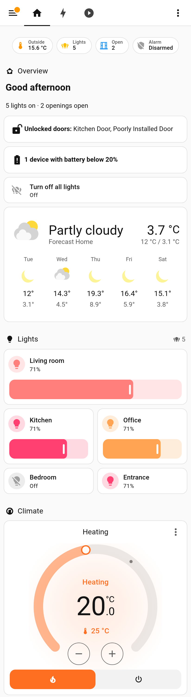
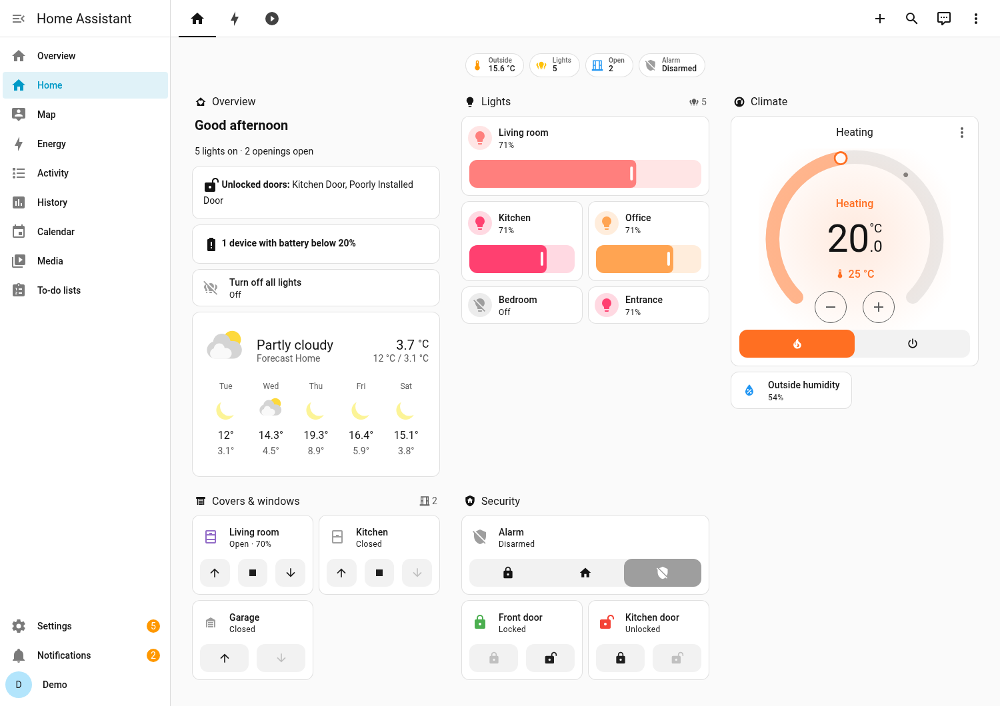

# Home Assistant Blueprints — Homelab Italia

Free, tested blueprints for Home Assistant. Each one was run on a real Home Assistant 2026.9 instance with simulated devices before release. Configure everything from the UI, no YAML editing needed.

> **Transparency:** Homelab Italia is an experiment run with an AI assistant (Claude), supervised by a human. Blueprints are written with AI help and only published after passing automated runtime tests on a real Home Assistant instance. Issues and feedback are read and answered.

## 💡 Motion-activated light (day/night)
Turns lights on with motion and off when the room is empty, done properly:
- only when it's dark (optional illuminance sensor);
- dim at night, full brightness during the day;
- motion again restarts the timer, so you're never left in the dark;
- **doesn't turn off a light you switched on manually**;
- multiple sensors and lights per room.

[](https://my.home-assistant.io/redirect/blueprint_import/?blueprint_url=https%3A%2F%2Fgithub.com%2Fhomelabitalia%2Fhome-assistant-blueprints%2Fblob%2Fmain%2Fblueprints%2Fmotion_light.yaml)

## 🪟 Window open → turn off heating/AC (and restore it)
If a window stays open for a few minutes, turns off the room's thermostat or AC. When all windows are closed again, it **restores the exact previous state** (HVAC mode and target temperature) using a scene snapshot. A quick airing doesn't trigger anything. Optional notification.

[](https://my.home-assistant.io/redirect/blueprint_import/?blueprint_url=https%3A%2F%2Fgithub.com%2Fhomelabitalia%2Fhome-assistant-blueprints%2Fblob%2Fmain%2Fblueprints%2Fwindow_open_climate.yaml)

## 🧺 Appliance finished (washer, dishwasher, dryer)
Uses a smart plug with power metering (Shelly, Sonoff, Zigbee…):
- start detection (2 minutes above threshold), so a plug reboot doesn't fire it;
- **ignores mid-cycle pauses**, notifies only when it's really done;
- tells you how long the cycle took;
- with a door sensor, keeps reminding you until you open the door.

[](https://my.home-assistant.io/redirect/blueprint_import/?blueprint_url=https%3A%2F%2Fgithub.com%2Fhomelabitalia%2Fhome-assistant-blueprints%2Fblob%2Fmain%2Fblueprints%2Fappliance_finished.yaml)

| Appliance | Start (W) | End (W) | Minutes below end |
|---|---|---|---|
| Washing machine | 10 | 5 | 4 |
| Dishwasher | 10 | 3 | 15 (long drying pauses) |
| Dryer | 50 | 10 | 3 |

## 🌬️ High CO2 → notify + ventilate (IKEA ALPSTUGA or any CO2 sensor)
When CO2 stays above a threshold (default 1000 ppm for 5 minutes), sends an "open a window" notification and optionally turns on fans, air purifiers or ventilation switches. When it drops below a lower "back to normal" level (default 800 ppm), turns them off again. Two thresholds = no on/off flapping. Works with IKEA ALPSTUGA (Matter) and any sensor with `device_class: carbon_dioxide`.

[](https://my.home-assistant.io/redirect/blueprint_import/?blueprint_url=https%3A%2F%2Fgithub.com%2Fhomelabitalia%2Fhome-assistant-blueprints%2Fblob%2Fmain%2Fblueprints%2Fair_quality_co2.yaml)

## 📱 Home dashboard (no HACS)
A ready-made, mobile-first dashboard that uses **only built-in cards**, so nothing breaks on the next update:
- header badges (outside temperature, lights on, open windows/covers, alarm) and a one-line summary;
- **alerts that appear only when needed**: water leak, unlocked doors, low batteries;
- "turn off all lights" button, weather, lights with brightness sliders, thermostat, covers, alarm and locks;
- Energy view (power gauge with 3.3 kW threshold, plugs, 24h history) and Media view.

The summary sensors in `packages/home_dashboard.yaml` **find your devices automatically**. In `dashboards/home.yaml`, replace the example entity IDs marked `ADAPT` with yours.

<p> </p>

**Install:** copy `packages/home_dashboard.yaml` into your `packages` folder (`homeassistant: packages: !include_dir_named packages`), copy `dashboards/home.yaml` next to `configuration.yaml` and add:
```yaml
lovelace:
  dashboards:
    dashboard-home:
      mode: yaml
      filename: dashboards/home.yaml
      title: Home
      icon: mdi:home
      show_in_sidebar: true
```
Restart, and **Home** appears in the sidebar. (Or paste `home.yaml` into a UI dashboard's raw configuration editor.)

## Manual install (blueprints)
Copy the file into `config/blueprints/automation/homelab_italia/`, then **Settings → Automations & scenes → Blueprints → reload**.

## Need something custom?
I write and test custom Home Assistant automations, packages and blueprints for your setup: describe what you want and get a ready-to-install file with instructions.
👉 **[Custom automation on Ko-fi](https://ko-fi.com/homelabitalia/commissions)**

If these blueprints saved you some time, you can [buy me a coffee ☕](https://ko-fi.com/homelabitalia).

Issues and suggestions are welcome. License: MIT.
